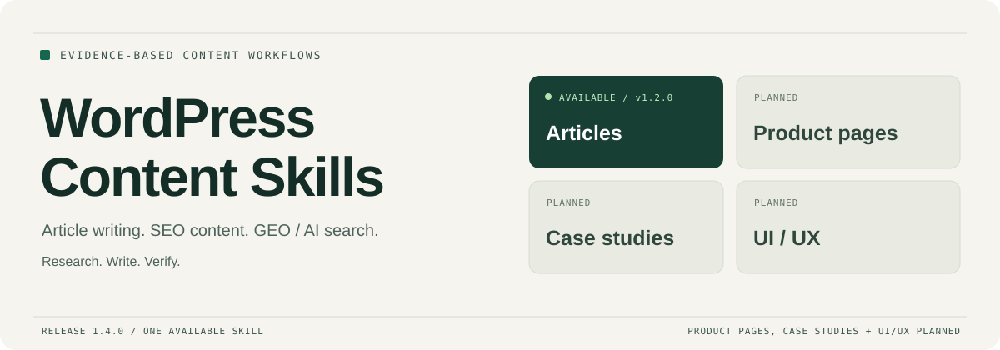
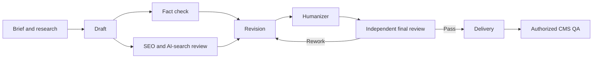

<p align="center">
  
</p>

<p align="center">
  <strong>Research. Create. Verify. Improve.</strong><br>
  A growing library of agent Skills for independent websites.
</p>

<p align="center">
  <a href="#install-in-magpie">Install</a> ·
  <a href="#workflow-catalog">Browse workflows</a> ·
  <a href="docs/architecture.md">Architecture</a> ·
  <a href="docs/maintenance.md">Maintenance</a> ·
  <a href="docs/roadmap.md">Roadmap</a> ·
  <a href="CONTRIBUTING.md">Contribute</a> ·
  <a href="CHANGELOG.md">Changelog</a>
</p>

---

## One library. Separate workflows.

Independent Site SOPs turns repeatable website work into scoped, installable Skills. Articles are the first module. Product pages, case studies, and UI/UX will have their own briefs, review criteria, and deliverables.

Each module lives in its own folder under `skills/`. Install the ones you need in Magpie and choose which Agent can use them.

**Current release:** `1.2.0` · **Available modules:** `2` · **License:** MIT

The repository URL and existing `independent-site-article` Skill name remain unchanged so current installation links continue to work.

## Workflow catalog

| Workflow | Status | Installable Skill | Scope |
| :--- | :--- | :--- | :--- |
| **Articles** | **Available** | [`independent-site-article`](skills/independent-site-article/SKILL.md) | Research, drafting, evidence checks, SEO and AI-search review, language editing, final review. |
| **Project maintenance** | **Available** | [`project-maintenance`](skills/project-maintenance/SKILL.md) | Triage feedback, inspect repository health, reproduce defects, prepare tested repairs, and preserve review evidence. |
| **Product pages** | Planned | Not released | Product specifications, purchase intent, substantiated benefits, comparisons, and conversion review. |
| **Case studies** | Planned | Not released | Customer permission, project evidence, measured outcomes, narrative, and attribution review. |
| **UI/UX improvements** | Planned | Not released | Existing-site audit, page structure, design handoff, responsive behavior, and implementation QA. |

Only **Available** modules can be installed. Planned modules are specifications, not placeholder Skills. See the [roadmap](docs/roadmap.md) and machine-readable [catalog](catalog.json).

## Install in Magpie

1. Open **Library → Skills → Find skills**.
2. Paste this repository URL:

   ```text
   https://github.com/METAXGTSEOSEM/independent-site-article-skills
   ```

3. Select **`independent-site-article`** for articles, **`project-maintenance`** for repository upkeep, or both.
4. Keep the complete Skill folder, including `references/`, `assets/`, and `agents/`.
5. Choose the Agent or Agents that should receive it.

New modules will appear separately when released. Installing one module does not install every future workflow or register seven global subagents.

## Maintain this library

The maintenance SOP is now an installable module in this repository. The article Skill still writes articles; the maintenance Skill looks after the library and its future modules.

- [Maintenance guide](docs/maintenance.md): scope, runtime state, scheduling, and limits.
- [Source configuration](maintenance/sources.json): GitHub Issues, PR feedback, and CI enabled for this repository; other sources disabled until configured.
- [Recurring-run prompt](maintenance/heartbeat-prompt.md): the bounded task replayed by an authorized scheduler.

Supported optional sources include GitHub Discussions, support email, standalone tickets, Discord, Telegram, Slack, X, Reddit, and application diagnostics. Website forms, embedded support widgets, and website checks are excluded.

Installing a Skill does not start a daemon. Recurring execution requires a host scheduler, working tools, and authorization. The default maintenance scope allows investigation, local fixes, and tests; remote commits, pushes, PR creation, merges, replies, and releases require separate authorization.

### Language editing dependencies

| Output language | Required Skill | Source |
| :--- | :--- | :--- |
| English, the default | `humanizer` | [blader/humanizer](https://github.com/blader/humanizer) |
| Chinese, only when explicitly requested | `humanizer-zh` | [op7418/Humanizer-zh](https://github.com/op7418/Humanizer-zh) |

All repository documentation, templates, Skill instructions, and interface metadata are in English. An explicit article-language request may override the English output default.

The required editor must actually be available and used. Missing dependencies are reported; ordinary rewriting is never labeled as a completed Humanizer pass. Third-party Skill text is not bundled.

## Start your first article

Use one main conversation per article. The coordinating assistant handles research, writing, reviews, and revisions.

```text
Use independent-site-article.

Website: [your website]
Topic or fixed title: [your topic]
Target market: [country]
Audience: [reader and knowledge level]
Business model: [B2B or B2C]
Goal: [what the reader should understand or do]
Available evidence: [specifications, original material, sources]

Write in English. Research before drafting.
Use humanizer for language editing and an independent final reviewer.
Save sources, draft versions, and review results.
Deliver the article and publishing fields. Do not upload or publish.
```

Use `$independent-site-article` where the host supports explicit Skill invocation. No specific model, paid research provider, or CMS connection is required. Missing capabilities limit what can be verified.

## How an article moves through review



| Role | Responsibility |
| :--- | :--- |
| Researcher | Search intent, first-party material, source records, and outline. |
| Writer | Evidence-based drafting and revisions. |
| Fact checker | Claims, figures, specifications, scope, and citations. |
| Search reviewer | Reader intent, SEO, AI-search considerations, and technical unknowns. |
| Language editor | The specified Humanizer, with meaning and sources preserved. |
| Final reviewer | Independent assessment of the exact edited version. |
| Publishing reviewer | CMS and page checks within the authorized scope. |

The coordinator can pass these roles to available general-purpose subagents. A host without delegation can produce a draft and self-review report, but must mark independent review as pending.

## What you receive

- A publishable-format draft in the requested language.
- H1, SEO title, meta description, slug, image notes, and relevant internal links.
- Source and claim records.
- A version-specific review decision: `PASS`, `REWORK`, or `BLOCKED`.
- A separate technical status: `TECH_PASS`, `TECH_REWORK`, or `TECH_NOT_CHECKED`.

`PASS` confirms the editorial workflow completed. It does not mean the page has been published, indexed, ranked, or cited by an AI search service.

<details>
<summary><strong>Quality boundaries</strong></summary>

- Verify current primary sources instead of treating the policy baseline as permanently current.
- Do not invent specifications, testimonials, experience, certifications, statistics, or search data.
- Recheck facts and qualifiers after language editing.
- Do not substitute word-count targets, keyword density, NLP scores, or AI-detector scores for review.
- Keep search-crawler access distinct from model-training permission.
- Require separate authorization for CMS writes, publishing, and production changes.
- Do not promise rankings, indexing, AI citations, or AI-detector results.

</details>

## Built to grow

```text
catalog.json                     Available and planned modules
skills/
  independent-site-article/      The first installable workflow
    SKILL.md
    agents/openai.yaml
    references/                  Workflow, roles, and policy sources
    assets/                      Blank production templates
  project-maintenance/           Feedback intake and verified repair workflow
maintenance/
  sources.json                  Repository-specific feedback configuration
  heartbeat-prompt.md           Bounded recurring-run instructions
docs/
  architecture.md               Packaging and compatibility rules
  roadmap.md                    Product, case-study, and UI/UX specifications
scripts/
  validate.py                   Catalog, packaging, language, and link checks
```

To add a workflow, follow [CONTRIBUTING.md](CONTRIBUTING.md). Each installable module must remain self-contained: Magpie may copy its folder without the rest of this repository.

Run the library checks with Python 3.9 or later:

```bash
python3 scripts/validate.py
```

## Updates and attribution

Check [CHANGELOG.md](CHANGELOG.md) before updating installed Skills. Preserve existing Skill identifiers; add new modules rather than expanding the article workflow into unrelated tasks.

The editorial process draws on evidence-based review and revision practices. Search guidance is checked against primary documentation, and language editing uses the specified external projects. See [THIRD_PARTY.md](THIRD_PARTY.md) for sources and [LICENSE](LICENSE) for the license covering this repository.
