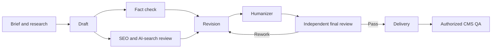

<p align="center">
  
</p>

<p align="center">
  <strong>Research. Write. Verify.</strong><br>
  Agent Skills for WordPress articles, SEO content, and GEO / AI search review.
</p>

<p align="center">
  <a href="#installation">Install</a> ·
  <a href="#workflow-catalog">Browse workflows</a> ·
  <a href="docs/architecture.md">Architecture</a> ·
  <a href="docs/roadmap.md">Roadmap</a> ·
  <a href="CONTRIBUTING.md">Contribute</a> ·
  <a href="CHANGELOG.md">Changelog</a>
</p>

---

# WordPress Content Skills

WordPress Content Skills provides evidence-based article writing and review for WordPress websites. The released article workflow covers research, drafting, fact-checking, SEO content review, and generative engine optimization (GEO) / AI search considerations.

Product pages, case studies, and UI/UX improvements are planned as separate modules with their own briefs, review criteria, and deliverables. They are not included in the current release.

**Current release:** `1.3.0` · **Available modules:** `1` · **License:** MIT

**Repository:** [METAXGTSEOSEM/wordpress-content-skills](https://github.com/METAXGTSEOSEM/wordpress-content-skills). The article Skill keeps its existing ID, `independent-site-article`, and version, `1.1.0`.

The workflow produces a manuscript and WordPress publishing fields. It runs in a compatible agent host; it is not a WordPress plugin. CMS access and publishing authorization are separate.

## Workflow catalog

| Workflow | Status | Installable Skill | Scope |
| :--- | :--- | :--- | :--- |
| **Articles** | **Available · v1.1.0** | [`independent-site-article`](skills/independent-site-article/SKILL.md) | Blog articles, buying guides, educational content, and existing-article review with research, evidence checks, SEO / GEO review, language editing, and final review. |
| **Product pages** | Planned | Not released | Product specifications, purchase intent, substantiated benefits, comparisons, and conversion review. |
| **Case studies** | Planned | Not released | Customer permission, project evidence, measured outcomes, narrative, and attribution review. |
| **UI/UX improvements** | Planned | Not released | Existing-site audit, page structure, design handoff, responsive behavior, and implementation QA. |

Only **Available** modules can be installed. Planned modules are specifications, not placeholder Skills. See the [roadmap](docs/roadmap.md) and machine-readable [catalog](catalog.json).

## Installation

Use your agent host's documented Skill installation method. The source repository is:

```text
https://github.com/METAXGTSEOSEM/wordpress-content-skills
```

1. Download the repository or use a host-supported repository installer.
2. Select only the available article module at `skills/independent-site-article/`.
3. Keep the complete folder, including `SKILL.md`, `references/`, `assets/`, and `agents/`. Copying only `SKILL.md` leaves required instructions and templates behind.
4. Install the required language editor listed below and make both Skills available to the coordinating assistant.
5. Confirm the host can load the Skill and its supporting files before starting an article.

For discovery and installation, use only entries marked `available` in [catalog.json](catalog.json). Planned modules have no installation path. Installing the article module does not register seven global subagents.

### Language editing dependencies

| Output language | Required Skill | Source |
| :--- | :--- | :--- |
| English, the default | `humanizer` | [blader/humanizer](https://github.com/blader/humanizer) |
| Chinese, only when explicitly requested | `humanizer-zh` | [op7418/Humanizer-zh](https://github.com/op7418/Humanizer-zh) |

All repository documentation, templates, Skill instructions, and interface metadata are in English. An explicit article-language request may override the English output default.

The required editor must actually be available and used. Missing dependencies are reported; ordinary rewriting is never labeled as a completed Humanizer pass. Third-party Skill text is not bundled.

## Start your first article

Use one main conversation per article. The coordinating assistant handles research, writing, reviews, and revisions.

```text
Use independent-site-article.

Website: [your WordPress website]
Topic or fixed title: [your topic]
Target market: [country]
Audience: [reader and knowledge level]
Business model: [B2B or B2C]
Goal: [what the reader should understand or do]
Available evidence: [specifications, original material, sources]

Write in English. Research before drafting.
Use humanizer for language editing, then an independent final reviewer.
Save sources, draft versions, and review results.
Deliver the article and publishing fields. Do not upload or publish.
```

Use `$independent-site-article` where the host supports explicit Skill invocation. No specific model, paid research provider, or CMS connection is required. Missing capabilities limit what can be verified.

## How an article moves through review



| Role | Responsibility |
| :--- | :--- |
| Researcher | Search intent, first-party material, source records, and outline. |
| Writer | Evidence-based drafting and revisions. |
| Fact checker | Claims, figures, specifications, scope, and citations. |
| Search reviewer | Reader intent, SEO, AI-search considerations, and technical unknowns. |
| Language editor | The specified Humanizer, with meaning and sources preserved. |
| Final reviewer | Independent assessment of the exact edited version. |
| Publishing reviewer | CMS and page checks within the authorized scope. |

The coordinator can pass these roles to available general-purpose subagents. A host without delegation can produce a draft and self-review report, but must mark independent review as pending.

## What you receive

- A publishable-format draft in the requested language.
- H1, SEO title, meta description, slug, image notes, and relevant internal links.
- Source and claim records.
- A version-specific review decision: `PASS`, `REWORK`, or `BLOCKED`.
- A separate technical status: `TECH_PASS`, `TECH_REWORK`, or `TECH_NOT_CHECKED`.

`PASS` confirms the editorial workflow completed. It does not mean the page has been published, indexed, ranked, or cited by an AI search service.

<details>
<summary><strong>Quality boundaries</strong></summary>

- Verify current primary sources instead of treating the policy baseline as permanently current.
- Do not invent specifications, testimonials, experience, certifications, statistics, or search data.
- Recheck facts and qualifiers after language editing.
- Do not substitute word-count targets, keyword density, NLP scores, or AI-detector scores for review.
- Keep search-crawler access distinct from model-training permission.
- Require separate authorization for CMS writes, publishing, and production changes.
- Do not promise rankings, indexing, AI citations, or AI-detector results.

</details>

## Built to grow

```text
catalog.json                     Available and planned modules
skills/
  independent-site-article/      The first installable workflow
    SKILL.md
    agents/openai.yaml
    references/                  Workflow, roles, and policy sources
    assets/                      Blank production templates
docs/
  architecture.md               Packaging and compatibility rules
  roadmap.md                    Product, case-study, and UI/UX specifications
scripts/
  validate.py                   Catalog, packaging, language, and link checks
```

To add a workflow, follow [CONTRIBUTING.md](CONTRIBUTING.md). Each installable module must remain self-contained because a host may copy its folder without the rest of this repository.

Run the library checks with Python 3.9 or later:

```bash
python3 scripts/validate.py
```

## Updates and attribution

Check [CHANGELOG.md](CHANGELOG.md) before updating installed Skills. Preserve existing Skill identifiers; add new modules rather than expanding the article workflow into unrelated tasks.

The editorial process draws on evidence-based review and revision practices. Search guidance is checked against primary documentation, and language editing uses the specified external projects. See [THIRD_PARTY.md](THIRD_PARTY.md) for sources and [LICENSE](LICENSE) for the license covering this repository.
